# Cyclic Injection and Abstraction in a Poroelastic Aquifer

**CEE 6755 — Computational Multiphysics · Tomás Schmieder · Spring 2025**

A two-dimensional hydro-mechanically coupled [MOOSE](https://mooseframework.inl.gov/)
model of a confined aquifer with a paired injection and abstraction well operating on a
500-second cycle. As the wells push and pull fluid in antiphase, a pressure wave travels
between them and the ground surface flexes in response. The study sweeps the permeability
tensor across eleven configurations — isotropic values from clay to karst, directional
anisotropy, and a fully cross-coupled tensor — plus a timestep-refinement run, and compares
the pore-pressure and surface-displacement fields that result.

<p align="center">
  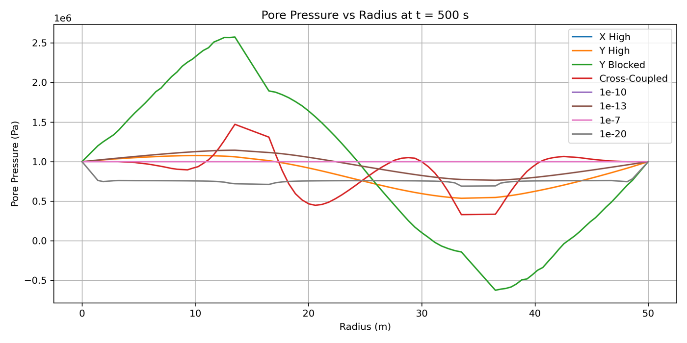
  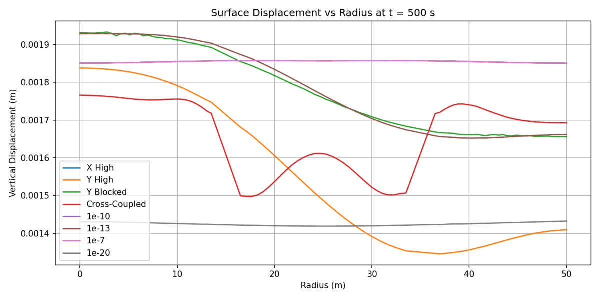
</p>

> **Every figure in this repository regenerates in about six seconds, with no simulation.**
> The sampled results live in `data/*.npz` (48 MB for the whole study), so a fresh clone can
> rebuild every plot and the summary table with `scripts/figures.sh`. This is a deliberate
> reset of an earlier version that kept **9 GB** of raw output and could not reproduce a
> single figure without re-running everything — see [Output volume](#output-volume-the-reset).

## Problem setup

The domain is a 50 m × 25 m confined aquifer in plane strain. An injection well at
x = 15 m and an abstraction well at x = 35 m, each 1 m in radius, sit at mid-depth. Both
run on the same 500 s sinusoid but in antiphase — while one injects, the other withdraws.
The left and right boundaries hold pressure at 1 MPa and pin horizontal displacement; the
base is fixed vertically. Six line samplers record pore pressure and vertical displacement
along the mid-depth line y = 12.5 m every timestep.

<p align="center">
  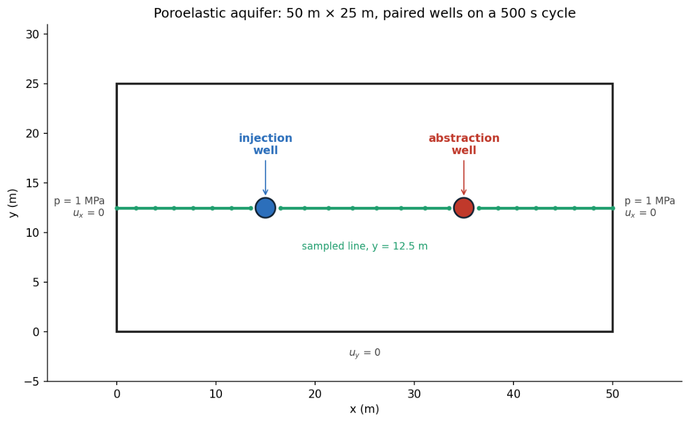
</p>

The mesh is graded — 2 m elements in the far field, refined to 0.25 m within 1 m of each
well, where the pressure gradients are steepest. It is generated from
[`mesh/cycle1.geo`](mesh/cycle1.geo), which reproduces the committed
[`mesh/cycle1.msh`](mesh/cycle1.msh) byte-for-byte under gmsh 4.13.1.

<p align="center">
  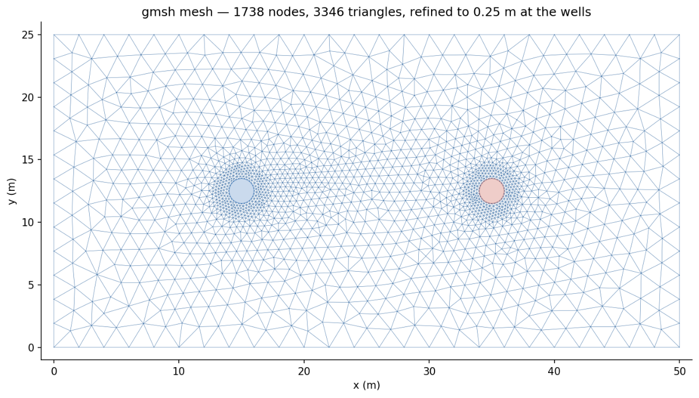
</p>

The wells are driven by a `PorousFlowSink` on each well boundary, with flux
q(t) = ±10⁴ · (315×10⁻⁶ / (2π · 1 · 20)) · sin(2πt / 500), injection positive. Two full
cycles run over the 1000 s simulation:

<p align="center">
  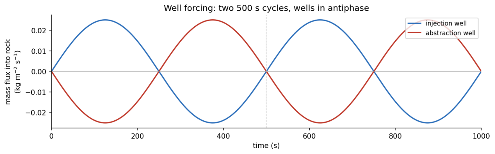
</p>

### Model summary

| | |
|---|---|
| **Physics** | `PorousFlowFullySaturated`, `coupling_type = HydroMechanical` |
| **Domain** | 50 m × 25 m, plane strain |
| **Wells** | radius 1 m; injection at x = 15 m, abstraction at x = 35 m, both at y = 12.5 m |
| **Mesh** | 1738 nodes / 3346 elements; 2.0 m background, 0.25 m at the wells |
| **Fluid** | `SimpleFluidProperties` — μ = 1×10⁻³ Pa·s, K = 2.1×10⁹ Pa, ρ₀ = 1000 kg/m³ |
| **Solid** | E = 5×10⁹ Pa, ν = 0.3, porosity 0.2, Biot coefficient 1.0, small strain, linear elastic |
| **BCs** | p = 1×10⁶ Pa and disp_x = 0 on left/right; disp_y = 0 on bottom |
| **Time** | implicit Euler, dt = 0.5 s to t = 1000 s (2000 steps), Newton + full SMP |
| **Size** | 5,214 nonlinear DOFs, 40,152 auxiliary DOFs |
| **Sampling** | six `LineValueSampler`s at y = 12.5 m, 30 points each |

## Governing equations

The model is **Biot linear poroelasticity**: a linear-elastic porous solid whose pores are
fully saturated with a slightly compressible fluid, with two-way coupling between the fluid
pressure and the solid deformation. MOOSE's `PorousFlowFullySaturated` action assembles the
coupled system below; nothing about the physics is custom to this repository.

Two fields are solved for simultaneously: the pore pressure $p(\mathbf{x},t)$ and the solid
displacement $\mathbf{u}(\mathbf{x},t) = (u_x, u_y)$.

### 1. Mechanical equilibrium

Inertia is negligible on these timescales, so the solid obeys quasi-static equilibrium.
Gravity is switched off in the model, leaving

$$
\nabla \cdot \sigma = \mathbf{0},
$$

where $\sigma$ is the **total** Cauchy stress (tension positive). Biot's effective-stress
principle splits the total stress into the part carried by the solid skeleton, $\sigma'$,
and the part carried by the pore fluid:

$$
\sigma = \sigma' - \alpha\, p\, \mathbf{I},
$$

with $\alpha$ the **Biot coefficient** ($\alpha = 1$ here). The skeleton is linear elastic
under the small-strain assumption:

$$
\sigma' = \mathbb{C} : \varepsilon
= 2G\,\varepsilon + \lambda\,\mathrm{tr}(\varepsilon)\,\mathbf{I},
\qquad
\varepsilon = \tfrac{1}{2}\!\left(\nabla \mathbf{u} + \nabla \mathbf{u}^{\top}\right),
$$

where $G$ is the shear modulus and $\lambda = K - \tfrac{2}{3}G$ the first Lamé parameter.
Substituting gives the mechanical equation actually solved:

$$
\nabla \cdot \left(\mathbb{C} : \varepsilon\right) - \alpha\, \nabla p = \mathbf{0}.
$$

The second term is the route by which **pressure drives deformation**.

### 2. Fluid mass conservation

Conservation of fluid mass for a fully saturated pore space, linearised about the reference
state, gives the **storage equation**:

$$
\underbrace{\frac{1}{M}\frac{\partial p}{\partial t}}_{\text{fluid + pore compressibility}}
+ \underbrace{\alpha\,\frac{\partial \varepsilon_v}{\partial t}}_{\text{skeleton dilation}}
+ \nabla \cdot \mathbf{q} = Q,
$$

where $\varepsilon_v = \mathrm{tr}(\varepsilon) = \nabla\cdot\mathbf{u}$ is the volumetric
strain, $Q$ a source/sink, and $1/M$ the **Biot modulus** — the amount of fluid that can be
squeezed into a unit volume held at constant strain per unit pressure rise:

$$
\frac{1}{M} = \frac{\phi}{K_f} + \frac{\alpha - \phi}{K_s}
\;\xrightarrow{\ \alpha = 1\ (K_s \to \infty)\ }\;
\frac{\phi}{K_f}.
$$

The $\alpha\,\partial\varepsilon_v/\partial t$ term is the route by which **deformation drives
pressure**: compressing the skeleton pressurises the fluid. Fluid flux follows Darcy's law
(gravity off):

$$
\mathbf{q} = -\frac{k}{\mu}\,\nabla p,
$$

with $k$ the intrinsic permeability (m², the tensor swept in this study) and $\mu$ the fluid
viscosity. Combining the two gives the pressure-diffusion equation with its mechanical
coupling term:

$$
\frac{1}{M}\frac{\partial p}{\partial t}
+ \alpha\,\frac{\partial \varepsilon_v}{\partial t}
= \nabla \cdot\!\left(\frac{k}{\mu}\,\nabla p\right) + Q.
$$

### 3. The coupling

The two equations are joined by the two $\alpha$ terms — this is what makes the problem
*multiphysics* rather than two separate solves:

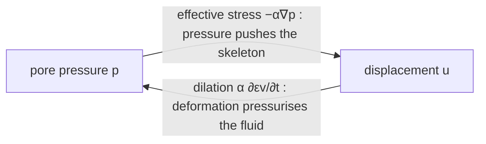

Because the coupling is two-way, the discrete system is solved monolithically with a full
Jacobian (see [§6](#6-time-integration-and-solver)).

### 4. Constitutive parameters

The elastic constants follow from $E = 5$ GPa and $\nu = 0.3$; the poroelastic constants
follow from those plus $\phi = 0.2$, $K_f = 2.1$ GPa, and $\alpha = 1$. These are computed in
[`scripts/make_theory_figures.py`](scripts/make_theory_figures.py) and written to
[`figures/derived_properties.csv`](figures/derived_properties.csv):

| Quantity | Symbol | Expression | Value |
|---|---|---|---|
| Drained bulk modulus | $K$ | $E / 3(1-2\nu)$ | 4.167 GPa |
| Shear modulus | $G$ | $E / 2(1+\nu)$ | 1.923 GPa |
| First Lamé parameter | $\lambda$ | $K - \tfrac{2}{3}G$ | 2.885 GPa |
| Constrained (oedometric) modulus | $K_v$ | $K + \tfrac{4}{3}G$ | 6.731 GPa |
| Biot modulus | $M$ | $K_f / \phi$ | 10.5 GPa |
| Storage coefficient | $S$ | $1/M + \alpha^2/K_v$ | $2.438\times10^{-10}$ Pa⁻¹ |

$K_v$ and $S$ are the combinations that appear once displacement is eliminated under confined
conditions — they set the diffusion speed in [§7](#7-dimensional-analysis-and-flow-regimes).

### 5. Boundary, initial, and forcing conditions

$$
\begin{aligned}
p &= 1\ \text{MPa}, \quad u_x = 0 && \text{on the left and right walls},\\
u_y &= 0 && \text{on the base},\\
\mathbf{q}\cdot\mathbf{n} &= g_{\text{inj}}(t) && \text{on the injection well},\\
\mathbf{q}\cdot\mathbf{n} &= g_{\text{abs}}(t) = -g_{\text{inj}}(t) && \text{on the abstraction well},\\
p &= 1\ \text{MPa}, \quad \mathbf{u} = \mathbf{0} && \text{everywhere at } t = 0.
\end{aligned}
$$

The wells are `PorousFlowSink` flux boundaries driven by

$$
g_{\text{inj}}(t) = A\,\sin\!\left(\frac{2\pi t}{T}\right),
\qquad
A = 10^4 \cdot \frac{315\times10^{-6}}{2\pi\,r_w\,h}, \qquad T = 500\ \text{s},
$$

which is a volumetric cycle amplitude ($10^4 \cdot 315\times10^{-6} \approx 3.15$ m³ s⁻¹)
spread over the well's cylindrical surface $2\pi r_w h$ ($r_w = 1$ m, screen length
$h = 20$ m) to give a flux of peak magnitude $A \approx 0.025$. The two wells run in
antiphase — while one injects, the other withdraws — so the pair drives a pressure wave
back and forth across the domain.

### 6. Time integration and solver

Time is advanced with **backward (implicit) Euler**, unconditionally stable, so
$\partial(\cdot)/\partial t \to \big[(\cdot)^{n+1} - (\cdot)^n\big]/\Delta t$ with all spatial
terms taken at $t^{n+1}$.
Each step is a nonlinear algebraic system $\mathbf{R}(\mathbf{U}) = \mathbf{0}$ in the
combined unknown $\mathbf{U} = (p,\,u_x,\,u_y)$ at every node, solved by **Newton–Raphson**:

$$
\mathbf{J}\,\delta\mathbf{U} = -\mathbf{R},
\qquad
\mathbf{J} =
\begin{bmatrix}
\partial \mathbf{R}_p/\partial p & \partial \mathbf{R}_p/\partial \mathbf{u}\\[2pt]
\partial \mathbf{R}_u/\partial p & \partial \mathbf{R}_u/\partial \mathbf{u}
\end{bmatrix}.
$$

The **off-diagonal blocks are the poroelastic coupling**; capturing them is why the
preconditioner is set to a Single-Matrix Preconditioner with `full = true` — it assembles the
complete coupled Jacobian rather than a block-diagonal approximation. `solve_type = newton`
with `nl_abs_tol = 1e-5`.

### The discrete (weak) form

Multiplying by test functions and integrating by parts once gives the residuals MOOSE
actually assembles. For a displacement test function $\mathbf{w}$ and a pressure test
function $\psi$:

$$
\mathbf{R}_u:\quad
\int_\Omega \sigma' : \nabla\mathbf{w}\,dV
\;-\; \int_\Omega \alpha\,p\,\nabla\cdot\mathbf{w}\,dV
\;=\; \int_{\partial\Omega} (\sigma\,\mathbf{n})\cdot\mathbf{w}\,dS,
$$

$$
\mathbf{R}_p:\quad
\int_\Omega \psi\!\left(\frac{1}{M}\frac{\partial p}{\partial t}
+ \alpha\frac{\partial \varepsilon_v}{\partial t}\right)dV
\;+\; \int_\Omega \nabla\psi \cdot \frac{k}{\mu}\nabla p \, dV
\;=\; \int_{\partial\Omega} \psi\,g(t)\,dS .
$$

Each term maps to one MOOSE object, which is the entire "code" of the physics:

| Weak-form term | MOOSE object |
|---|---|
| $\int \sigma':\nabla\mathbf{w}$ | `StressDivergenceTensors` |
| $-\int \alpha p\,\nabla\cdot\mathbf{w}$ | `PorousFlowEffectiveStressCoupling` |
| $\int \psi\,\tfrac{1}{M}\,\partial_t p$ | `PorousFlowMassTimeDerivative` |
| $\int \psi\,\alpha\,\partial_t \varepsilon_v$ | `PorousFlowMassVolumetricExpansion` |
| $\int \nabla\psi \cdot \tfrac{k}{\mu}\nabla p$ | `PorousFlowFullySaturatedDarcyFlow` |
| well flux $\int \psi\,g(t)$ | `PorousFlowSink` |
| far-field $p$, fixed $\mathbf{u}$ | `DirichletBC` |

$\mathbb{Q}_1$ Lagrange elements interpolate all three fields on the triangular mesh.

### 7. Dimensional analysis and flow regimes

Eliminating displacement from the coupled system under confined conditions collapses the
pressure equation to a diffusion equation, $\partial p/\partial t = c\,\nabla^2 p$, with
**hydraulic diffusivity**

$$
c = \frac{k}{\mu\,S}, \qquad S = \frac{1}{M} + \frac{\alpha^2}{K_v}.
$$

The single dimensionless group that organises the whole permeability sweep compares the time
for pressure to diffuse across the well spacing $L = 20$ m against the forcing period $T$ — a
Deborah number:

$$
\mathrm{De} = \frac{\tau_{\text{diff}}}{T} = \frac{L^2}{c\,T} = \frac{\mu\,S\,L^2}{k\,T}.
$$

- $\mathrm{De} \ll 1$ — pressure equilibrates far faster than the wells cycle, so the field
  stays near-uniform at the boundary value (gravel, karst, and the non-physical $10^{-3}$ case).
- $\mathrm{De} \sim 1$ — diffusion and forcing are matched; the wells "communicate" within a
  cycle and the travelling pressure wave is most developed (**medium sand**, $\mathrm{De}\approx2$).
- $\mathrm{De} \gg 1$ — the signal cannot cross the domain in a cycle and stays trapped as
  steep local gradients around each well (silt, clay).

<p align="center">
  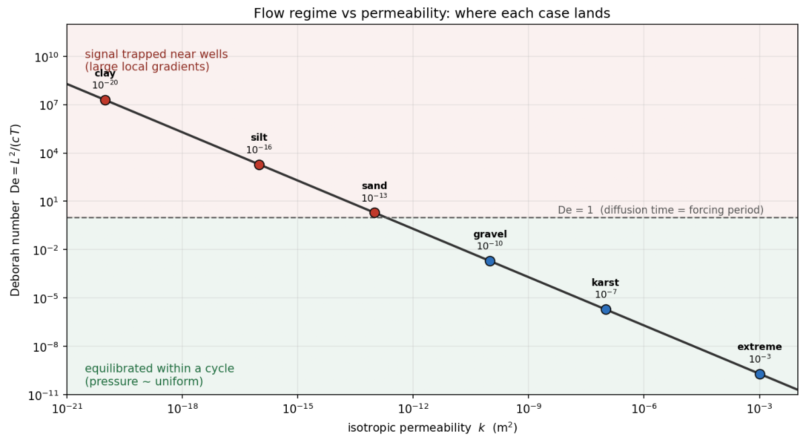
</p>

The measured peak pore pressure follows this reading: it is pinned at the 1 MPa boundary for
the high-permeability cases and rises as permeability falls and the fixed well flux must be
driven through an ever-tighter medium. The **silt case ($10^{-16}$) is an outlier** — a
~22 MPa local spike that breaks the otherwise monotone trend. This is the same "abnormal
behaviour" the original author flagged in the analysis notebook; it is reported here rather
than smoothed over, and is worth a dedicated look (mesh resolution at the well, or the
fixed-flux boundary interacting with the near-impermeable medium).

<p align="center">
  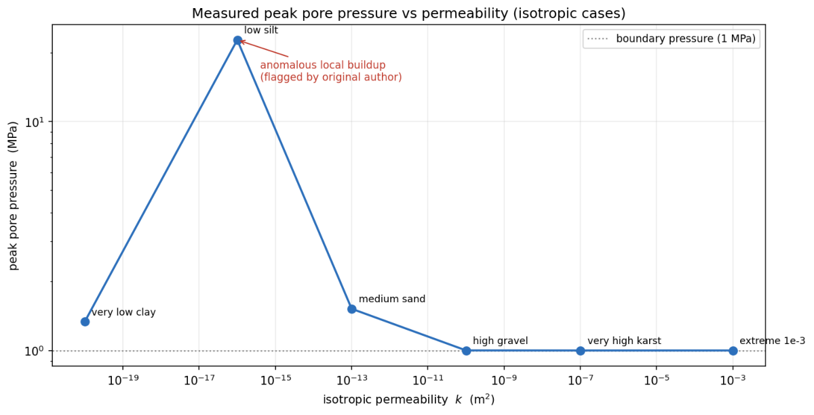
</p>

## Results gallery

All figures were produced by [`scripts/figures.sh`](scripts/figures.py) from the committed
`data/` archives. Each per-case figure shows pore pressure (left) and vertical surface
displacement (right) as surfaces over radius and time.

**Isotropic permeability sweep.** As permeability drops from gravel to clay, the aquifer
goes from near-instantaneous pressure equilibration to almost no through-flow, and the
pressure field changes character completely:

<p align="center">
  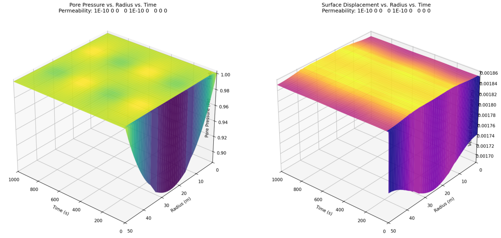
  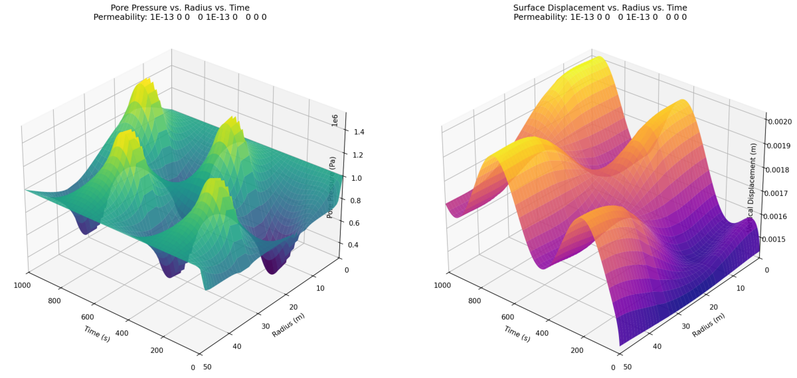
</p>
<p align="center">
  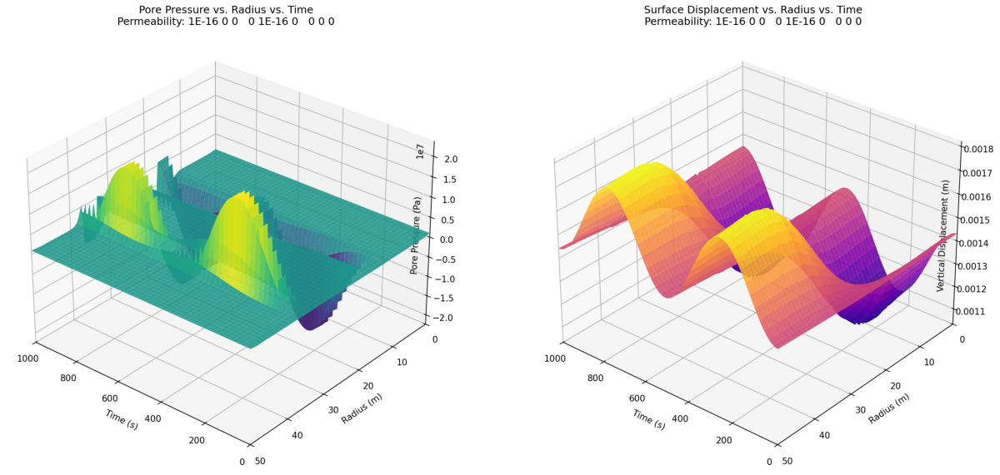
  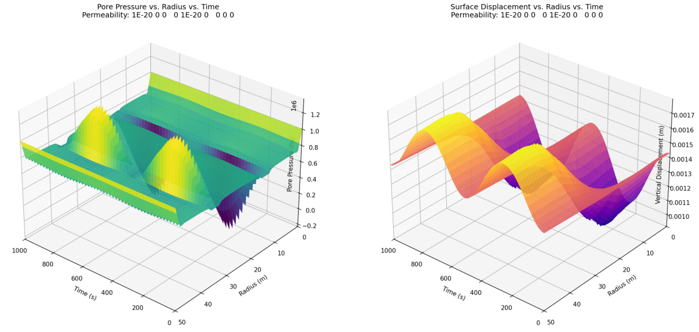
</p>

This is the [regime map](#7-dimensional-analysis-and-flow-regimes) made visible. Gravel
(1×10⁻¹⁰, top left, De ≈ 2×10⁻³) barely departs from the 1 MPa boundary — fluid moves
freely, so the cyclic forcing never builds pressure. Medium sand (1×10⁻¹³, top right,
De ≈ 2) sits at the resonant regime where the wells communicate within a cycle and the
travelling pressure wave is most developed. Silt (1×10⁻¹⁶, De ≈ 2×10³) and clay (1×10⁻²⁰,
De ≈ 2×10⁷) are both in the trapped regime, holding the signal as steep local gradients
around each well — with the silt case showing the anomalous pressure spike discussed above.

**Anisotropy and directional blocking.** When permeability is high along one axis and low
along the other, flow channels; `y_blocked` suppresses vertical flow entirely:

<p align="center">
  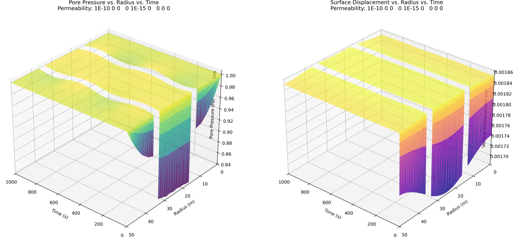
  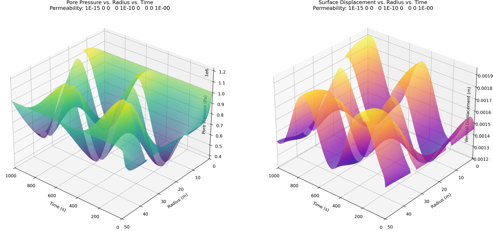
  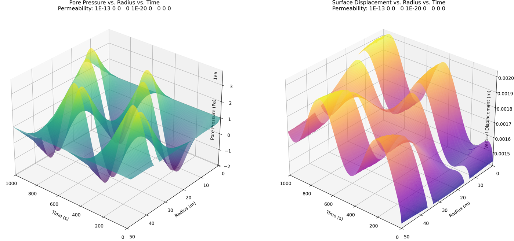
</p>

**The two extreme cases — and a corrected label.** The genuine karst case (1×10⁻⁷, left)
and the non-physical 1×10⁻³ upper bound (right) both equilibrate almost instantly, but they
are *not* the same run. In the original study these two inputs accidentally wrote to the
same output directory, so the report's "karst" figure actually shows the 1×10⁻³ case. The
two are correctly separated here — see [Corrections](#corrections-to-the-submitted-report):

<p align="center">
  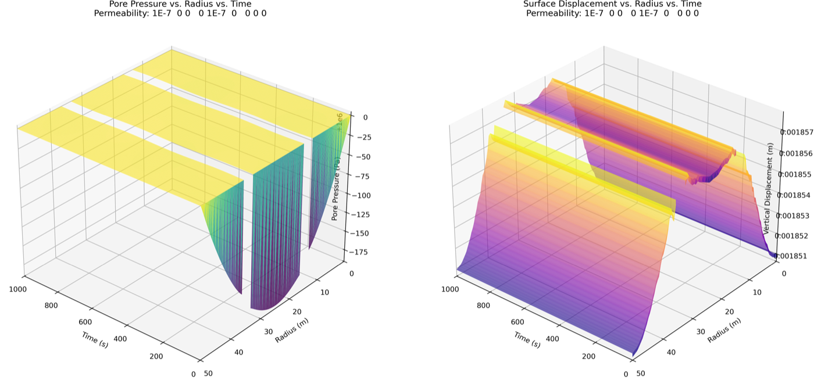
  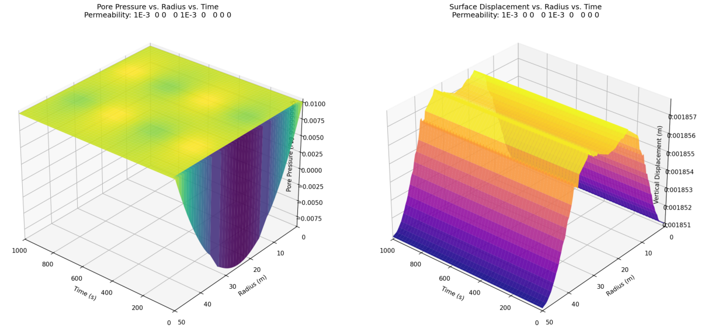
</p>

## Cases

There is **one input file**, [`inputs/cycle.i`](inputs/cycle.i). Each case is that model
with its permeability applied as a command-line override, driven from
[`cases.csv`](cases.csv) — no per-case copies. Units are m².

| Case | k_xx | k_yy | Off-diagonal | Notes |
|---|---|---|---|---|
| `base` | 1×10⁻¹³ | 1×10⁻¹³ | 5×10⁻¹⁴ | mildly cross-coupled reference |
| `high_gravel` | 1×10⁻¹⁰ | 1×10⁻¹⁰ | — | gravel |
| `medium_sand` | 1×10⁻¹³ | 1×10⁻¹³ | — | medium sand |
| `low_silt` | 1×10⁻¹⁶ | 1×10⁻¹⁶ | — | silt |
| `very_low_clay` | 1×10⁻²⁰ | 1×10⁻²⁰ | — | clay, effectively impermeable |
| `very_high_karst` | 1×10⁻⁷ | 1×10⁻⁷ | — | karst |
| `extreme_1e-3` | 1×10⁻³ | 1×10⁻³ | — | non-physical upper bound, brackets the response |
| `anisotropic_x_high` | 1×10⁻¹⁰ | 1×10⁻¹⁵ | — | flow channelled along x |
| `anisotropic_y_high` | 1×10⁻¹⁵ | 1×10⁻¹⁰ | — | flow channelled along y |
| `cross_coupled` | 1×10⁻¹³ | 1×10⁻¹³ | 1×10⁻¹³ | fully cross-coupled |
| `y_blocked` | 1×10⁻¹³ | 1×10⁻²⁰ | — | vertical flow suppressed |
| `very_low_clay_dt0.05` | 1×10⁻²⁰ | 1×10⁻²⁰ | — | timestep refinement: dt = 0.05 s, 20,000 steps |

Command-line overrides are exact — they produce byte-identical output to editing the value
into the file, which was verified before adopting this structure.

## Data

`data/<case>.npz` holds the complete sampled result for one case: pore pressure and
vertical displacement on a (timestep × x) grid, float64, plus the time and x axes and a
metadata blob. One case is 0.8–2.6 MB. These are committed, so figures and the summary table
are reproducible from a clean clone without running anything.

```python
import numpy as np, json
z = np.load("data/medium_sand.npz")
json.loads(str(z["meta"]))   # case, permeability, dt, n_steps, n_x
z["pressure_vals"]           # (2000, 90) Pa
z["disp_vals"]               # (2000, 90) m
z["time"], z["x"]            # axes
```

float64 is deliberate — float32 halves the size but cannot resolve the ~10⁻⁷ Pa differences
that separate the high-permeability cases (`very_high_karst` peaks at 1000000.670386 Pa,
`extreme_1e-3` at 1000000.000067 Pa).

## Output volume (the reset)

The original version of this study wrote **758 MB per case, about 9 GB for the sweep**,
which made the repository impossible to distribute and the figures impossible to reproduce
without re-running everything. Measured breakdown of one case, and what changed:

| | before | after |
|---|---|---|
| Exodus field file | 693 MB | off by default (~18 MB with `--exodus`) |
| Per-timestep sampler CSVs | 47 MB, 12,000 files | transient, deleted after archiving |
| **Kept per case** | **758 MB** | **2.6 MB** (`data/<case>.npz`) |
| **Kept for the sweep** | **~9 GB** | **48 MB** |

Three things did the work:

1. **The Exodus file was 97% of the bytes, and 88% of *that* was noise.** It carried 12
   auto-generated elemental variables — nine stress components and three Darcy velocities,
   of which five are identically zero in 2D plane strain — at 16.4 MB against 2.1 MB for the
   three nodal fields actually used. `show = 'disp_x disp_y porepressure'` plus
   `interval = 10` takes it from 693 MB to ~18 MB. Since no figure needs it, it is off
   unless you pass `--exodus`.
2. **12,000 CSV files per case held very little information.** The study needs pore pressure
   and disp_y as a function of x and time: 2000 × 90 × 2 float64 values. Reshaped into dense
   arrays and compressed, that is 2.6 MB — a 293× reduction with no data loss.
3. **Committing the archives inverts the workflow.** Figures now come from `data/`, in
   seconds, on any machine.

Verified: all twelve archives, and a fully fresh re-simulation of four of them, reproduce
the previous pipeline's results **bit-for-bit** — identical to the last digit and matching
at the MD5 level, including the report's own reference value of 1335587.1563765 Pa.

<details>
<summary><b>What was tried and rejected</b></summary>

- **`contains_complete_history = true` on the samplers** collapses 300 files into 6 exactly
  as the name suggests — and **silently corrupts the data**. A `LineValueSampler` holds only
  the current line, and `SamplerBase::initialize()` skips the clear when the flag is set, so
  rows accumulate unevenly: a 50-step run produced 1500 rows with only 145 distinct values,
  x = 13.5 appearing 1065 times and x = 0 once. It looks like a 30% win and is a data-loss
  bug. Do not use it.
- **float32 archives** are half the size and cannot represent the differences that
  distinguish the high-permeability cases.
- **A direct LU preconditioner** cuts linear iterations 87× (8,872 → 102 over 50 steps) but
  changes wall time by only ~6%: the cost of this model is PorousFlow material evaluation,
  not the linear solve. Left off by default so results stay bit-identical to the report.
  Enable with `Preconditioning/basic/petsc_options_iname='-pc_type'
  Preconditioning/basic/petsc_options_value='lu'`.
- **Coarser output intervals** (every 5th step) cost 0.0007% on peak pressure and 0.03% on
  the mean — irrelevant scientifically, but they break exact reproduction of the report and
  the archives are already small, so it buys nothing.

</details>

## Repository layout

```
inputs/cycle.i          the single input; cases differ only by command-line override
cases.csv               case table: permeability, dt, tolerances, labels
mesh/cycle1.geo         gmsh source; regenerates cycle1.msh byte-for-byte
mesh/cycle1.msh
src/ include/ test/     the MOOSE app (stork scaffold, no custom C++)
scripts/setup.sh        create the miniforge environment
scripts/env.sh          activate it + rpath shim; sourced by the other scripts
scripts/run.sh          run cases from cases.csv
scripts/archive.py      raw sampler CSVs -> data/<case>.npz
scripts/figures.sh      data/*.npz -> figures/
scripts/make_readme_assets.py   the schematic, mesh render, forcing plot, and previews
scripts/make_theory_figures.py  the regime diagram, peak-pressure plot, derived_properties.csv
data/                   committed sampled results, one .npz per case
figures/                figures and summary.csv, all regenerable from data/
analysis/cyclic.ipynb   the original 2025 notebook, kept as a record
docs/                   report, assignment brief, and CORRECTIONS.md
results/                raw output — gitignored, transient
```

The application is named `borehole1` (baked into `Makefile` and the registration macros),
so `make` produces `borehole1-opt`. It has no custom C++ — it is the unmodified `stork`
scaffold with the `porous_flow` and `solid_mechanics` modules enabled. All of the physics
is in the input file.

## Getting started

Requires [miniforge](https://github.com/conda-forge/miniforge) — not Anaconda or Miniconda
— and a MOOSE checkout as a **sibling directory**, because `Makefile` resolves `MOOSE_DIR`
to `$(dirname $PWD)/moose`:

```
projects/
├── moose/                              # github.com/idaholab/moose
└── Cyclic-Injection-Borehole-MOOSE-FEM/
```

```bash
git clone https://github.com/windy-schmieder/Cyclic-Injection-Borehole-MOOSE-FEM.git
cd Cyclic-Injection-Borehole-MOOSE-FEM

scripts/setup.sh                                    # create the miniforge env
git -C ../moose checkout a7c04635529b5e7deb1cc7c080894582cfdb5cff
source scripts/env.sh
make -j8
```

`scripts/setup.sh` also applies the macOS rpath workaround described under
[Troubleshooting](#troubleshooting). Set `MINIFORGE_ROOT` or `MOOSE_ENV` if your
installation differs from `~/miniforge` and `moose`.

### Reproducing the figures without simulating

```bash
scripts/figures.sh                     # rebuild every figure from data/*.npz  (~6 s)
```

### Running the simulations

```bash
scripts/run.sh --list                  # show the cases
scripts/run.sh medium_sand             # one case            (~4 min)
scripts/run.sh                         # the full sweep, sequentially
scripts/run.sh --jobs 4                # four cases at a time
scripts/run.sh --exodus medium_sand    # also write the ParaView field file
```

Each case takes about 4 minutes, writes ~20 MB of raw sampler CSVs into `results/<case>/`,
folds them into `data/<case>.npz`, and deletes the raw files. Cases are independent serial
solves, so `--jobs N` scales nearly linearly — three concurrent cases finished in 310 s
versus ~870 s sequentially on a 10-core machine.

## Troubleshooting

**`Library not loaded: @rpath/libgfortran.5.dylib ... (duplicate LC_RPATH '@loader_path')`**

conda-forge's `libgfortran5` 13.2.0 ships `libgfortran.5.dylib` and `libquadmath.0.dylib`
with `@loader_path` declared twice as an `LC_RPATH`. dyld on macOS 15 and newer rejects that
outright, so neither `borehole1-opt` nor `import numpy` will load. It is a packaging bug, not
a MOOSE or project problem.

```bash
scripts/fix_macos_rpaths.sh
```

writes patched, re-signed copies into `.rpath-shim/`, which `scripts/env.sh` puts ahead of
the environment on `DYLD_LIBRARY_PATH`. **Nothing inside the miniforge environment is
modified.** The permanent fix is updating `libgfortran5` in that environment.

Related trap: the scripts invoke Python by absolute path rather than through
`#!/usr/bin/env python3`, because `/usr/bin/env` is SIP-protected and macOS strips `DYLD_*`
when exec'ing it — which would discard the shim and break numpy.

## Corrections to the submitted report

[docs/CORRECTIONS.md](docs/CORRECTIONS.md) documents errors in `docs/report.pdf`, which is
the original submission and is unaltered. The most consequential: two input files wrote to
the same output directory, so the figure captioned as karst (k = 1×10⁻⁷) actually shows
k = 1×10⁻³. Re-running both cases and comparing against the archived output settles it — the
archived data is bit-identical to the 1×10⁻³ run. The figures here have the two cases
correctly separated.

## License

LGPL-2.1, inherited from the MOOSE application template. See [LICENSE](LICENSE).
